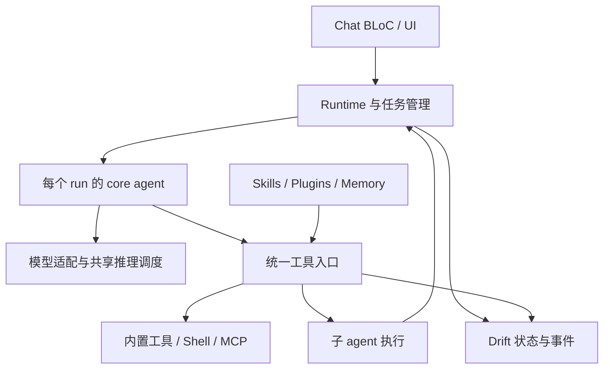

# GSMLG Agent Runtime — dart_agent_core 实施计划与 Codex Goal

日期：2026-11-07（Asia/Shanghai）  
目标仓库：https://github.com/gsmlg-app/gsmlg  
核对基线：88088dd9acc687a28db3662bf43f349185cb3395  
状态：实施方案；本文件不表示下述功能已经实现或发布。

## 1. 确定的方向

采用 dart_agent_core 管理每个 agent 的模型—工具循环。GSMLG 管理执行身份、父子任务、共享模型资源、工具执行、Shell/MCP 连接、持久化、插件安装和长期记忆。

本次不再进行框架替换比较。初始适配基线为已核查的 dart_agent_core 2.1.9；实施时检查依赖约束与锁文件，若需要升级，先核对 API 和迁移差异。通过现有 workspace 依赖方式接入，不直接把整个上游源码复制到业务目录。

目标是一个可实际使用的 chat agent：能够调用现有工具、执行受支持平台的命令、委派具名子 agent、连接 MCP、按需加载 skills、使用 Plugin 1.0 组件、检索有来源的记忆，并通过 hooks 扩展生命周期。

Agent 实例采用独立运行状态。默认不要求一个 agent 对应一个 Dart isolate。模型后端、Vault、数据库与连接池可共享；请求、执行会话、可变状态和取消域必须明确归属。Isolate 用于有必要转移的 CPU/阻塞工作，不代表操作系统级执行隔离。

## 2. 当前代码基线与必须保留的行为

本次读取的是远端 main 的固定提交，不能把 2026-10-30 交付的未合入补丁当成现有实现。

| 当前事实 | 对实施的影响 |
| --- | --- |
| app_lib/chat/pubspec.yaml 尚无 dart_agent_core；chat/lib/src 尚无 agent 目录 | 需要真正接入 runtime，而不是仅启用某个配置 |
| ChatBloc 仍负责工具执行后重新启动模型调用 | 移出循环，保留会话、UI、标题、TTFT 和在途写入管理 |
| 现有工具处理和 provider 缓冲转换不能完整保留同轮全部调用 | 必须先收集完整模型轮、保留调用 ID，再执行完整调用批次 |
| RemoteLlmRepository 已依赖 openai_compatible / anthropic_compatible | 继续使用共享协议包，不在新 runtime 内再实现一套 HTTP |
| OpenAiMessage 当前只有 role 和 String content；Responses input 复用该类型 | 最小扩展共享请求模型，表达原生调用/结果和内容块 |
| GemmaRepository 已接 app_local_llm 移动后端 | 保留平台路由和模型所有权，不按旧补丁恢复早期后端 |
| GemmaRepository.stopGeneration 当前为空；移动 facade/interface 尚无请求级取消契约 | UI 取消与原生计算结束分开记录；不得提前复用仍被占用的推理槽 |
| LocalModelAccess 是共享、非重入的模型访问协调 | 子 agent 不能等待父 agent 持有的同一独占 lease |
| 数据库仍为 schema 19，消息缺少 native tool-call metadata | 增量迁移，保存协议元数据与稳定顺序，兼容已有会话 |
| AssistantMessage.completedSuccessfully 与自动标题有关 | 迁移后继续保留成功终态语义 |
| ToolExecutor 已有内置工具与 MCP，但没有 Shell 工具或 run context 参数 | 增加统一执行上下文和取消路径，再挂接 Shell |
| Terminal Host 已有 execute/shell 与 ExecutionSession | 复用后端，创建 agent 自己拥有的会话 |

实际本地模型 workspace 路径是 app_plugin/local_llm/local_llm 及其 platform_interface/android/ios 子包，不是 app_lib/local_llm。

保留现有 MiniCPM 自动标题、会话切换与草稿、远端并发、精确 generationId 取消、模型配置和凭据读取。移动端现有多模态限制应如实保留；agent loop 不会自动增加原生推理能力。

## 3. 架构与所有权

名称是职责建议，可以匹配仓库惯例调整；避免为每个职责建立一个新 package。

| 层 | 所有权 |
| --- | --- |
| ChatBloc / UI | 用户输入、会话切换、展示投影、工具卡片、任务树、停止与继续操作 |
| ChatAgentRuntime | 根 run 入口，创建 core 实例，连接事件与持久化，处理应用终态 |
| AgentSupervisor | 子 run 注册、父子关系、任务状态、共享预算、等待与取消传播 |
| RepositoryAgentLlmClient | 将现有 repository 的完整模型轮映射到 core LLMClient |
| Model execution coordinator | 模型驻留/卸载协调、单次推理许可、排队与取消完成边界 |
| Tool registry + gateway | 工具发现、参数校验、能力范围、hooks、执行意图、结果 receipt |
| Shell execution service | 本地进程、PTY、SSH 会话、输入输出、退出状态、超时和清理 |
| Skill / plugin registries | 索引、加载、安装版本、启用状态、组件注册和可用能力 |
| Memory provider | 有 scope 和来源的 session/note/memory 检索与读写 |
| Drift repositories | transcript、run/child 状态、工具 invocation、配置与索引元数据 |

### 身份和状态

明确区分 agentDefinitionId、agentId、conversationId/sessionId、runId、parentRunId、modelRequestId 和 toolCallId。toolCallId 按其所属 run/模型轮定位，不假设供应商 ID 全局唯一。

应用内部 invocation ID 与 provider-native call ID 分开保存。供应商提供或协议要求的原生 ID 必须原样保留；合法且受支持的本地/旧文本工具格式如果没有原生 ID，可以用已持久化的 modelRequestId 与 call index 生成稳定的应用 ID。不得为损坏的远端调用补造必需的原生 ID；身份映射在历史重建时保持一致。

配置与事件使用不可变数据；状态变化尽量用纯转换函数表达。I/O、进程和连接放在少量明确的边界中，复用现有 Dart/BLoC 风格。

每个 root/child run 拥有独立的 AgentState、取消域、请求 adapter，以及有状态的 hook、skill 激活状态、loop detector 和 compressor。不可把父 agent 的可变对象直接共享给 child。

应用执行记录是 UI 状态的依据。至少区分 queued、running、waiting、cancelling、completed、failed、cancelled、interrupted。core 的 isRunning 不能直接作为应用成功/取消终态。

## 4. 核心执行与协议保真

模型生成一个完整 turn 后，按顺序：

1. 校验终止状态，收集该轮所有 tool calls。
2. 保存 assistant 原始内容、全部调用以及调用意图。
3. 持久化成功后才开始工具执行。
4. 每个调用实际完成后，由 gateway 立即保存自己的 receipt。
5. 全部结果按原生 call ID 配对，交回 core 继续下一轮。
6. 最终响应形成应用成功终态；失败或取消形成不同终态。

不完整 JSON、缺失协议必需的调用身份、重复调用身份、缺少合法完成边界、截断的工具轮都不能派发有副作用的工具。合法的本地无原生 ID 调用按上述规则归一化。保留原始 arguments；不能将解析失败伪装成空对象。

远端必须保持：

- Chat Completions 的 assistant tool_calls / tool_call_id。
- Responses 的 function_call / function_call_output 与 call_id。
- Anthropic tool_use / tool_result、内容块顺序及需要回传的签名/推理字段。
- 已有多模态内容、采样设置、provider 扩展参数和非流式模式。

流式和非流式路径具有相同的完成/错误判断。不要引入重复 HTTP 客户端；需要的类型能力在 app_api/openai_compatible 和必要的 anthropic_compatible 边界最小扩展，保持旧调用方兼容。

所有模型轮创建独立 assistant 记录，包括 hook 请求继续但没有工具调用的轮次。完整响应用于校准已显示文本，不应重复追加。保持 TTFT 与 completedSuccessfully 的既有语义。

## 5. 工具执行、MCP 与 hooks

### 一个实际执行入口

内置工具、MCP、Shell、插件工具、skill 脚本和子 agent 委派都经过 gateway。内部自动增加的 core 工具也必须审计，防止其绕过应用的执行与资源边界。

执行上下文由应用注入，不能信任模型传入的 runId/owner。有效能力取用户/项目配置、父 agent 委派范围、组件声明与平台实际能力的交集。复用已经存在的授权；不要给每次普通工具调用追加重复确认。

before-tool hooks 可变换参数；变换后的最终参数需要重新校验。参数 schema 校验应发生在派发之前。对于需要等待用户或外部输入的操作，保存可恢复的 waiting 状态，不长期占用模型推理许可。

在等待授权、取得排队许可、持久化意图等异步步骤后，紧邻实际派发重新检查 run 身份与取消状态。准备完成但尚未派发的取消调用，与已经启动但结果未知的调用分开记录。

默认按模型轮中的顺序串行派发有副作用的工具；只有声明可安全并行且互不依赖的调用才并发。对识别到的同一资源冲突保留一致顺序，不能仅排列最终结果而让实际执行发生竞态。等待子 agent 时，不持有它需要的工具或资源锁。

工具定义具有稳定来源 ID、命名空间和版本。多个 MCP server 中同名工具不能覆盖。大量工具采用索引/搜索/按需描述方式进入上下文；不把全部 MCP schemas 无条件加入每次模型请求。

### MCP

首阶段通过已有 ToolExecutor / DartMcpToolClient 桥接，保留当前可工作的配置、Vault 与 HTTP/stdio 路径。dart_mcp 与 core 带入的 mcp_dart 是不同包，依赖存在不等于完成 transport 迁移。

选择一个清晰的 MCP 连接所有者；如需迁移，建立显式适配和协议互操作测试，不同时维护两套无主连接。连接按 server/身份配置归属，单次请求有自己的超时和取消。取消一个 run 不关闭其他 run 共用的连接。

只声明实际协商、实现并验证的能力。stdio 只在支持进程的后端启用；移动端/Web 的远程 MCP 不能因全局导入 dart:io 被破坏。错误结果和无法确认的远端操作都要进入执行记录。

### Hooks

提供有序、有界的 run/model/tool 生命周期扩展，覆盖前处理、结果变换、失败、取消和清理。明确不同 hook 失败行为；观察/日志 hook 的失败与决定是否执行的 hook 失败不能混为一谈。

Hooks 使用每 run 的实例或明确无状态函数。hook continuation 消耗同一预算，避免无限继续。插件 hook 与脚本仍走相同的执行约束；不能修改能力集合后直接获得额外授权。

## 6. 持久化与恢复语义

Transcript、run 状态和每个 invocation 的 receipt 存到应用数据库。采用单调事件/消息序号作为排序依据，时间戳用于展示和审计，不仅依靠秒级 timestamp。

可以在现有消息表加版本化 metadata，并增加必要的 run/invocation 表。迁移号根据实施时实际 schema 递增，不硬套旧补丁的 schema 20。旧消息无 metadata 仍可读取。

Invocation 至少区分 prepared、started、succeeded、failed、cancelled、unknown。能够确认未派发与无法确认外部效果的情况必须分开。将每个 receipt 写在 gateway 内，不等待 core 返回整个工具批次后才开始记录。

失败恢复规则：

- assistant/意图保存失败：不执行该工具。
- 工具已产生效果但 receipt 保存失败：停止后续依赖执行，记录/呈现未知状态；不能自动再执行。
- 只有已知幂等、提供幂等键或可查询结果的操作才进行相应重试/核实。
- 重启不自动重放未确认的 Shell、DNS、云服务写操作。
- 协议需要时，可补充明确说明“先前结果未知”的历史 tool result；这不等于真实成功，也不触发重执行。
- 取消后的迟到 receipt 可以更新 invocation 审计结果，但不能重启旧 run 或修改新 run 的 UI。
- 普通执行不承诺 exactly-once。恢复能力按工具类型和远端支持说明。

恢复 waiting task 时先确认具体等待条件。用户选择“继续”不等于重新派发全部历史工具。

## 7. Shell 设计

### 执行后端

- 桌面普通命令：采用 process_run 1.4.2 作为初始候选，核对约束并验证实际进程清理。
- 交互终端：复用现有 terminal_core / terminal_hosts 与 PTY 后端。
- 远程命令：复用 app_ssh / 已有 SSH host 与凭据配置，不另建一份 SSH 账户存储。
- Android/iOS：按现有 backend 能力启用；不把桌面 Bash 能力当成移动端能力。无本地执行能力时明确返回不支持；SSH/远程执行可独立可用。

Agent 创建专属执行会话。复用终端基础代码，不默认向用户正在使用的终端 tab 注入命令。

### 建议工具契约

| 工具 | 输入/行为 |
| --- | --- |
| exec_command | 目标 host、工作目录、显式执行模式、命令/argv、PTY 需求、等待时间和执行超时；短任务返回结果，长任务返回执行句柄 |
| write_stdin | 属于当前 agent 的 session_id、输入内容，以及可选的读取/等待参数 |
| read_process_output | 根据 session_id 和输出游标读取增量结果；如合并进 write_stdin/poll，保持同样语义 |
| terminate_session | 请求结束指定执行会话，返回可确认的终止状态 |

命令与 argv 的语义明确区分，特别是 SSH 后端不能用未经转义的参数拼接冒充 argv API。复杂 shell 语法显式交给目标 shell 解释。

非交互结果可以包含 stdout、stderr、exitCode；PTY 返回合并 output。所有模式返回状态、输出游标、截断标记与可用的退出/信号信息，未知退出码不能伪造为 0。

yield/wait 超时与命令执行 deadline 分开。持续 drain 进程输出，采用有界缓冲与日志；不能因返回给模型的文本达到上限而停止读取管道。处理 UTF-8 分片、背压和超大输出。

取消与收尾：

- 建立会话、排队、启动进程的每个阶段都能观察取消。
- 本地清理覆盖后代进程，PTY close 与进程树结束分别确认。
- SSH 断线或 channel 关闭不能自动解释为远端进程已经停止。
- run-owned 会话在成功、失败、取消时都有收尾规则。
- 若允许长期后台任务，必须显式转成 conversation/workspace-owned task，有持久记录、UI 和独立取消入口；不保留无人管理的孤儿进程。
- 普通 Shell 会话管理不是操作系统沙箱。平台限制、工作目录选择与执行授权应按产品已有配置体现，不做虚假的隔离承诺。

## 8. Sub-agent 设计

采用应用 supervisor 创建具名 worker。core 的默认通用 clone 先关闭，通过应用控制的委派工具创建 fresh core run，避免继承可变状态和父 agent 全部资源。

第一版提供 spawn、status/wait、cancel；可以使用 spawn_agent / wait_agent / cancel_agent 等命名。每个 child 有独立 session/context、角色配置、模型策略、事件和能力子集。父代理传入目标、明确上下文片段与必要 artifact 引用，收到带来源的结果摘要及 artifact，不共享整个可变 transcript。

整棵任务树共享并发、深度、模型轮数、工具调用数和 token/成本预算。预算预留必须原子化；供应商不返回 usage 时采用保守估计或其他明确上限，不能声称精确费用控制。

父取消向后代传播；子取消不影响父或兄弟。根 run 完成前需要汇集、取消或显式移交其未完成子任务。等待子 agent 不占本地推理槽。

### 本地模型的关键调度约束

把模型驻留/卸载生命周期与单次推理独占许可分清：

- 只有真正的模型生成占 inference permit。
- 执行工具、等待子代理、等待用户时释放该 permit。
- 子代理不再次申请父代理整个 run 持有的同一非重入独占 lease。
- 本地 child 默认使用同一个已驻留模型；不同本地模型的切换必须经过调度检查，不在父 run 使用期间偷偷卸载。
- 原生取消不可用时可以先取消 UI/run，但继续占用底层资源直到原生结束或可靠隔离/终止。
- 等待结束的实现应能 drain/观察 native completion，不能丢掉唯一完成信号。
- 不因本地队列阻塞远端 agent，也不静默将本地任务发送到云端。

UI 至少显示父子任务树、状态、工具活动、结果和取消入口。

## 9. Skills、Plugin 1.0 与 Memory

### Skills

索引名称、描述、来源和版本，按需加载 SKILL.md 正文。文件读取与脚本执行分开：读取说明不自动执行脚本，脚本通过已注册工具和支持的后端运行。

处理目录遍历、符号链接与失效版本引用；这些检查属于加载器正确性。skill 的 allowed-tools 等声明只收窄/请求能力，不授予能力。移动端不默认依赖 Node；确实需要脚本 runtime 的技能按平台可用性标识。

### Plugin 1.0

以用户已选定的 Backplane 分发格式、对应版本的 Plugin 1.0 规范以及真实导出 fixture 为准，实现安装、启用、禁用、升级、卸载与组件注册。不要自造一份 JSON 然后宣称兼容。

第一版应能把插件携带的 skills、MCP 配置和受支持的 hooks/命令接入上述注册表。对于当前平台或当前实现不支持的组件，显示明确状态和原因，不能显示为完整启用。

活动 run 固定插件内容版本和配置快照；升级安装原子切换，避免读到半份内容。禁用/撤销后阻止新的执行，已有调用按可用取消能力处理；内容文件在仍被引用时不能被提前删除。

这是 agent 插件，和 Flutter 编译期 native plugin 分开。运行时不下载 Dart 包动态编译进入 Flutter。连接信息使用现有 Vault 引用，安装包不能直接取得应用所有凭据。

本次实现消费端与 Backplane 适配，不另做插件 marketplace 服务。

### Memory

区分当前模型上下文、会话 transcript 和跨会话长期记忆。core 的压缩/episodic recall、FileStateStorage 都不直接等价于 GSMLG 的长期记忆系统。

建立应用自己的 memory provider：至少提供 scoped search/read，以及明确的写入/更新/删除路径。第一版要有可工作的本地存储或已有服务 adapter，不能用恒为空的占位实现宣称完成。

检索结果携带来源类型、项目/会话/对象 ID、版本、时间和内容 hash。先过滤 scope/可见范围，再检索排序；避免不同会话或项目记忆相互泄漏。区分用户明确事实、agent 推断和工具观察，矛盾信息不静默覆盖。

Embedding 通过独立 provider 注入，索引记录模型 ID、版本与维度。沿用单独的 ONNX/embedding 计划，不在本任务重造推理引擎。若 embedding 暂不可用，提供并标识实际可工作的文字检索 fallback。更新和删除同步使索引失效。

## 10. 实施阶段和完成条件

P0 → P1 → P2 为公共基础；之后 Shell 和 sub-agent 可由不同工程任务并行推进。P5 的 skills/plugin 与 memory 可以在稳定接口后并行。共享模型和数据库协议变更串行合并。

| 阶段 | 交付 | 完成条件 |
| --- | --- | --- |
| P0 基线 | 当前 HEAD、依赖与已有行为清单 | 核对旧补丁、真实 package 路径、当前 schema、SDK 和平台能力；保留用户现有改动 |
| P1 Core 与协议 | core loop、模型 adapter、完整消息协议、BLoC 接入、增量迁移 | 所有调用/结果配对；不执行截断轮；旧消息可读；会话切换、TTFT、成功标题保持 |
| P2 工具执行基础 | 统一 gateway、调用上下文、逐调用 journal、hooks、MCP 桥接 | 意图先保存；单个结果完成即记账；最终参数校验；取消相互隔离 |
| P3 Shell | 本地命令、PTY、SSH、输出与真实进程收尾 | 长命令可继续读取/输入；取消无已知孤儿进程；无法确认的远端结果准确标识 |
| P4 Sub-agent | 具名 worker、并行、共享预算、本地调度、任务树 UI | 本地主/子可完成；父子取消正确；排队取消不误伤；预算限制对整树生效 |
| P5 扩展与记忆 | 可用 skills、真实 Plugin 1.0 loader、memory provider/recall | 真实 fixture 安装/禁用/升级；能力不扩大；记忆有来源、可更新删除并实际被检索 |
| P6 收口 | 重启与中断恢复、平台验证、回归、文档 | 完整 demo 路径、scoped tests、实际平台证据、剩余边界准确说明 |

每阶段都应产生能运行的行为。接口、空实现或永久关闭的功能开关不能算实现完成。

## 11. 验证矩阵

只运行受影响 package 的必要测试和分析，按具体风险扩展。保留已有测试，不通过删除断言“修复”回归。

- 协议：一个 turn 多个工具；跨 SSE 分片的 arguments；非流式等价；重复 ID；合法本地无原生 ID 的多工具轮；远端缺失必需 ID；截断/错误 finish；签名和多模态 round-trip。
- 持久化：保存意图失败不派发；工具生效后保存失败不重放；批次中一个完成、一个挂起时已完成 receipt 可见；同一时间戳的稳定顺序；旧 schema 迁移。
- 派发：同一轮 create→update 的真实执行顺序；安全只读并行仍逐条记录 receipt；意图保存阻塞期间取消、保存完成后不执行；取得执行许可时取消不启动外部操作。
- 并发：两个远端会话同时运行；取消一个不影响另一个；切换会话/新 run 后迟到事件不可覆盖。
- 本地推理：运行中取消、排队取消、取得 permit 时取消；原生尚未结束不能开启下一次互斥推理；父调用本地 child 不死锁。
- Shell：真实本地进程的输出、stdin、退出码、后代进程取消、启动竞态、大量输出与 UTF-8 分片；SSH fake/loopback 与至少一次可用平台 smoke 区分记录。
- Sub-agent：独立状态、上下文边界、父子取消、共享预算、子失败回传、未完成任务终态收尾。
- 扩展：重复工具名、MCP 断线/超时、插件禁用和版本切换、非法路径、hook 递归/超时、无脚本 runtime 平台。
- Memory：项目/会话过滤、来源保留、更新/删除索引、文字 fallback、上下文预算。
- UI：任务树与工具活动真实反映 run；PTY 合并输出；错误与 unknown 状态；无工具 continuation 新消息；MiniCPM 标题与 completedSuccessfully。

重点测试目录：app_lib/chat/test、app_bloc/chat/test、app_lib/database/test、app_lib/terminal_core/test、app_lib/terminal_hosts/test、app_api/openai_compatible/test，以及实际变更的 local_llm/其他协议包测试。

使用 fake LLM、loopback 协议服务和真实无害本地子进程覆盖确定行为。真实模型、Android/iOS、各桌面构建分开报告；mock 通过不等于真机验证。

## 12. 最终交付

- 可工作的集成代码、必要依赖锁定与数据库迁移。
- docs/chat-agent-runtime.md：所有权、执行/取消/恢复、平台能力、扩展边界。
- 最小可运行的 root → tools → child → recall → final 演示，以及 Shell 长任务演示。
- scoped tests 与实际平台检查证据；已实现、已测试、已发布分开描述。
- 合理的初始化默认值和产品可见的能力状态。
- 在既有工作流授权下提交/推送；不因为写计划或跑测试自动部署 App Store、Play Store 或在线服务。

## 13. Codex execution prompt (English)

Implement the GSMLG chat agent runtime described in this document using dart_agent_core. The framework choice is settled. Deliver working behavior across the stages below; do not reopen the framework comparison.

Repository: https://github.com/gsmlg-app/gsmlg  
Reviewed baseline: 88088dd9acc687a28db3662bf43f349185cb3395  
Initial inspected framework version: dart_agent_core 2.1.9.

### Goal

Make GSMLG's existing Flutter chat execute a complete model/tool loop with native protocol fidelity, application-owned execution records, controlled sub-agents, usable Shell/SSH tools, MCP integration, skills, Plugin 1.0 consumption, memory recall, and lifecycle hooks.

Keep the app in control of UI/session state, credentials, model resources, tool effects, persistence, and platform capabilities. Use dart_agent_core for the actual model/tool iteration inside each run; do not rebuild another competing loop in ChatBloc.

### Start from the actual checkout

Read applicable repository instructions, the current source and lockfile, and this plan. Work on the existing branch; do not create a branch or worktree unless the user asks. Preserve newer compatible changes and unrelated local edits.

The earlier 2026-10-30 integration was an unmerged patch, not the current implementation. At the reviewed baseline, app_chat does not depend on dart_agent_core, chat/lib/src has no agent directory, and the database schema is 19. Recheck these facts before editing.

Current RemoteLlmRepository uses app_api/openai_compatible and app_api/anthropic_compatible. OpenAiMessage currently stores only role and String content, and Responses input reuses that type. Extend these shared models minimally to represent real tool calls/results and multimodal content; do not bypass them by adding a parallel HTTP stack.

The mobile model packages are under app_plugin/local_llm, including local_llm, local_llm_platform_interface, local_llm_android and local_llm_ios. GemmaRepository.stopGeneration is currently empty, and the mobile contract lacks request-scoped native cancellation. Do not treat stream cancellation as proof that native inference stopped.

### Preserve the existing application

Retain ChatBloc's conversation separation, drafts/navigation behavior, run identity checks, ordered pending writes, TTFT and title generation. Preserve AssistantMessage.completedSuccessfully and the MiniCPM title-only purpose.

Keep RemoteLlmRepository's endpoints, Vault authentication, provider-specific options and request-scoped cancellation. Keep GemmaRepository and the platform backends responsible for model loading and native resources. Register new shared services through MainProvider. Follow the repository's workspace dependency conventions.

Favor immutable configuration/events, pure state transitions and explicit effect boundaries. Avoid broad package restructuring and inheritance-heavy abstractions.

### Runtime and model boundary

Create fresh core state, cancellation, request adapters and stateful hooks/skills/compressors/loop detectors for every root or child run. Shared model services, database, Vault and connection pools are permitted; shared mutable run state is not.

Use app-owned event types and stable execution identities. Distinguish agent definitions, agent/session identity, run identity, parent run, model request and tool call. Persist ordered events or equivalent stable sequence metadata. The application's execution record determines UI terminal state; do not derive it from core.state.isRunning.

Collect a complete model turn before dispatching tools. Preserve all calls, raw arguments, call IDs, provider content order and required reasoning/signature fields. Support equivalent streamed and non-streamed behavior. Reject malformed or truncated tool turns without executing partial effects.

Store application invocation identity separately from provider-native call identity. Preserve native call IDs exactly where the protocol supplies or requires them. For a supported local/legacy backend that legitimately provides no native IDs, assign stable application IDs scoped to the persisted modelRequestId and call index. Persist the mapping for history reconstruction; do not invent replacement native IDs for malformed remote calls whose protocol requires them.

Keep Chat Completions tool_calls/tool_call_id, Responses function_call/function_call_output/call_id, and Anthropic tool_use/tool_result intact. Preserve existing multimodal inputs where the underlying backend supports them.

Separate model residency/lifecycle protection from the exclusive permit for one native inference request. Never hold an inference permit while awaiting tools, user input or a child. A child must not reacquire a non-reentrant lease held by its waiting parent. Until reliable model switching is implemented, local children may inherit the resident local model. Do not silently route local work to a cloud provider.

When native cancellation cannot be confirmed, cancel the logical run promptly while retaining the resource permit until native completion or reliable termination is observed. Do not launch overlapping work into a backend that is still busy.

### Tool gateway and persistence

Route all app, MCP, Shell, skill-script, plugin and delegation tools through one application-owned execution gateway. Audit any tools implicitly injected by the framework. Keep implicit generic cloning disabled unless its lifecycle and capability semantics have been replaced by app-controlled behavior.

Bind execution ownership in application code, not in model-provided arguments. Apply hook transformations, validate final arguments and effective capabilities, then persist intent before dispatch. Effective capabilities must not exceed existing user/project grants, parent delegation, component declarations and platform support. Reuse existing authorization; do not add repeated confirmations to ordinary already-authorized calls.

After any approval wait, queue acquisition or intent persistence, recheck run identity and cancellation immediately before dispatching the external effect. Distinguish cancellation of a prepared, never-started invocation from cancellation after dispatch with an unknown outcome.

Execute side-effecting calls serially in model-turn order by default. Parallelize only calls declared safe and independent, and preserve ordering for identified conflicts on the same resource. Ordering returned results is not a substitute for ordering execution. Never retain a tool/resource lock across a child wait if that child needs the same resource.

Persist the assistant turn and invocation intent before external execution. Persist each tool receipt in the gateway immediately after that tool completes, even if another tool in the same core batch is still pending. This must not depend solely on a batch-completed core event.

Represent unknown effects separately from failure or confirmed cancellation. If an effect happens but saving its receipt fails, stop dependent progression and do not replay it automatically. On restart, do not repeat unconfirmed Shell/DNS/cloud writes. Use idempotency or outcome queries only where the concrete tool supports them. Do not claim exactly-once external effects.

Late results may reconcile the invocation record but must not restart a cancelled run or overwrite its replacement. Migrate old conversations compatibly and use stable ordering rather than second-resolution timestamps alone.

### Shell and SSH

Implement usable exec_command, write_stdin/poll, output retrieval and terminate_session behavior over a run-owned execution registry.

Evaluate process_run 1.4.2 for desktop noninteractive execution and process-tree cleanup. Reuse terminal_core, terminal_hosts, PTY and app_ssh for existing platform and SSH backends. Do not create a second credential/configuration store or inject commands into the user's active terminal tab by default.

Distinguish command-string and argv execution; quote SSH arguments correctly. Distinguish a response wait/yield duration from the execution deadline. Return a handle for long-running commands, bounded output with cursor/truncation metadata, and truthful exit/signal/outcome information.

Continuously drain process output even after the model-visible output limit is reached. Handle partial UTF-8, backpressure, startup cancellation races and descendant process cleanup. PTY output is merged; do not fabricate separate stdout/stderr. SSH channel closure or disconnect is not proof that remote processes stopped.

Clean up run-owned execution sessions on success, failure and cancellation. Long-lived tasks require explicit transfer to a managed conversation/workspace owner with a visible record and independent cancellation. Never leave accidental orphan tasks.

Expose only real platform capabilities. Desktop shell support does not imply iOS host Bash. Unsupported local execution must remain distinguishable from supported remote execution.

### Sub-agents

Build application-supervised named workers, each backed by a fresh dart_agent_core run. Provide spawning, status/wait and cancellation, with independent context and explicit capability subsets. Return sourced summaries/artifact references to the parent.

Track a real task tree. Parent cancellation propagates to descendants; child cancellation does not cancel siblings or the parent. Resolve, cancel or explicitly transfer outstanding children before the root finishes.

Enforce atomic shared budgets for the whole tree: depth, concurrency, model turns, tool calls and token/cost limits where measurable. Do not reset the root budget for each child. Add task-tree UI and the relevant states.

Verify a local parent can delegate to a local child without deadlocking and that cancellation of a queued child does not abort the active sibling inference.

### MCP, skills, plugins, memory and hooks

Bridge existing MCP execution first. dart_mcp and mcp_dart are different dependencies; do not accidentally operate duplicate unmanaged connections. Keep server/tool namespaces stable, respect negotiated capabilities, and scope request cancellation without closing unrelated shared sessions. Support the currently available transport modes with capability-specific behavior.

Index skills by metadata and load SKILL.md content on demand. Reading a skill must not execute its scripts automatically. Scripts use the same gateway and platform execution backends. Validate paths and version references. Skill declarations cannot grant capabilities.

Implement a real Plugin 1.0 consumer using the actual versioned specification and Backplane export fixtures. Provide install/enable/disable/update/uninstall and registration of supported skill/MCP/hook components. Do not invent an incompatible manifest and label it compliant. Pin active-run component versions, install updates atomically, and report unsupported components truthfully. Do not dynamically compile downloaded Dart packages into Flutter. This task does not create another marketplace server.

Keep memory separate from transcript storage and core context compression. Deliver a working scoped search/read and explicit write/update/delete provider backed by local storage or an existing service. Results must include provenance, scope, identity, version/time and content hash. Apply visibility filtering before ranking; keep update/delete indexes consistent. Distinguish user facts from model inferences.

Integrate embedding through an injectable provider and version its index metadata. Follow the separate ONNX/embedding project direction rather than implementing another inference engine here. If embedding is unavailable, implement an actual labeled text-search fallback, not an empty stub.

Provide bounded, ordered lifecycle hooks with clear failure semantics. Revalidate modified tool arguments and capabilities before dispatch. Continuations consume the same run/tree budgets. Hook cleanup cannot block shutdown indefinitely.

### Execution stages

Complete P0 baseline reconciliation, P1 core/protocol integration, P2 gateway/journal/hooks/MCP bridge, P3 Shell, P4 sub-agents, P5 skills/plugins/memory, and P6 recovery/platform/regression documentation.

After P2, delegate independent Shell and sub-agent work in parallel where possible. Plugin/skill and memory work can proceed independently after their shared contracts stabilize. Coordinate shared model/protocol/database edits.

Do not stop at scaffolding, empty adapters or permanently disabled features. Resolve routine implementation choices from the checkout and this plan. If a concrete external/platform requirement blocks one part, continue the independent authorized work and report the exact remaining boundary.

### Validation and completion

Run focused tests and static analysis for changed packages. Cover complete tool batches, native protocol round-trips, malformed/truncated turns, intent/receipt failures, immediate per-tool receipts, old-schema migration, ordering, concurrent chats and isolated cancellation.

Cover valid local multi-call turns without native call IDs and invalid remote turns missing mandatory IDs. Test create-then-update execution order, safe parallel reads with immediate receipts, and cancellation during blocked intent persistence or queue acquisition: once those waits finish, the cancelled call must still produce no external dispatch.

Use deterministic fake models, loopback provider/MCP peers and real harmless local child processes where appropriate. Test long-running output/input, process-tree cleanup, startup races, SSH unknown outcomes, child ownership/budgets, local parent-child scheduling, plugin lifecycle/path behavior, and scoped memory update/delete/recall.

Keep current session/navigation/TTFT/title regressions. Report real-model, device and platform build checks separately from mocks. Do not inflate unexecuted platform coverage.

Update docs/chat-agent-runtime.md with architecture, ownership, cancellation/recovery, platform support, plugin/skill compatibility and memory provenance. Include reproducible root-to-tools-to-child-to-recall and long-shell demonstrations, actual test evidence, migrations, configuration and material limits.

Follow the session's existing commit/push/release authorization and repository workflow. Do not create a new branch/worktree by default or deploy to running services/app stores merely to finish this feature. If a bug in an organization-owned dependency blocks required behavior, follow the user's upstream issue-routing rule rather than hiding it with a local workaround.

Finish with what is implemented, what was verified, remaining concrete limitations, and delivery references. Keep implemented, tested, merged and released status distinct.

## 14. 证据与参考

### 固定仓库基线

- [Chat 依赖](https://github.com/gsmlg-app/gsmlg/blob/88088dd9acc687a28db3662bf43f349185cb3395/app_lib/chat/pubspec.yaml)
- [ChatBloc](https://github.com/gsmlg-app/gsmlg/blob/88088dd9acc687a28db3662bf43f349185cb3395/app_bloc/chat/lib/src/chat/bloc.dart)
- [RemoteLlmRepository](https://github.com/gsmlg-app/gsmlg/blob/88088dd9acc687a28db3662bf43f349185cb3395/app_lib/chat/lib/src/repositories/remote_llm_repository.dart)
- [GemmaRepository](https://github.com/gsmlg-app/gsmlg/blob/88088dd9acc687a28db3662bf43f349185cb3395/app_lib/chat/lib/src/repositories/gemma_repository.dart)
- [LocalModelAccess](https://github.com/gsmlg-app/gsmlg/blob/88088dd9acc687a28db3662bf43f349185cb3395/app_lib/chat/lib/src/repositories/local_model_access.dart)
- [OpenAI 兼容请求模型](https://github.com/gsmlg-app/gsmlg/blob/88088dd9acc687a28db3662bf43f349185cb3395/app_api/openai_compatible/lib/src/openai_compatible.dart)
- [Anthropic 兼容请求模型](https://github.com/gsmlg-app/gsmlg/blob/88088dd9acc687a28db3662bf43f349185cb3395/app_api/anthropic_compatible/lib/src/anthropic_compatible.dart)
- [移动端模型 facade](https://github.com/gsmlg-app/gsmlg/blob/88088dd9acc687a28db3662bf43f349185cb3395/app_plugin/local_llm/local_llm/lib/app_local_llm.dart)
- [移动端模型接口](https://github.com/gsmlg-app/gsmlg/blob/88088dd9acc687a28db3662bf43f349185cb3395/app_plugin/local_llm/local_llm_platform_interface/lib/src/local_llm_platform.dart)
- [ToolExecutor](https://github.com/gsmlg-app/gsmlg/blob/88088dd9acc687a28db3662bf43f349185cb3395/app_lib/chat/lib/src/services/tool_executor.dart)
- [Terminal Host](https://github.com/gsmlg-app/gsmlg/blob/88088dd9acc687a28db3662bf43f349185cb3395/app_lib/terminal_core/lib/src/host.dart)
- [MainProvider](https://github.com/gsmlg-app/gsmlg/blob/88088dd9acc687a28db3662bf43f349185cb3395/app_lib/provider/lib/src/main.dart)
- [数据库与迁移](https://github.com/gsmlg-app/gsmlg/blob/88088dd9acc687a28db3662bf43f349185cb3395/app_lib/database/lib/src/database.dart)

### 第三方与历史材料

- [dart_agent_core](https://pub.dev/packages/dart_agent_core)；本计划以 2.1.9 的已核查能力为初始适配基线。
- [process_run](https://pub.dev/packages/process_run) 与 [Shell 文档](https://github.com/tekartik/process_run.dart/blob/master/packages/process_run/doc/shell.md)；进程树清理细节仍需在目标平台实测。
- [flutter_pty](https://pub.dev/packages/flutter_pty)、[dartssh2](https://pub.dev/packages/dartssh2)；实施优先适配项目锁定版本，避免无关升级。
- [Backplane](https://github.com/gsmlg-opt/backplane)：Plugin 1.0 消费兼容性以实际规范引用与导出 fixture 验证，本文件没有虚构其 API 或 manifest 字段。
- Agent Note project=gsmlg-app，记录 19aef626-7c85-4287-866d-53e723f7ea3a：2026-10-30 的未合入实现评审，只作为历史设计与测试经验参考。

